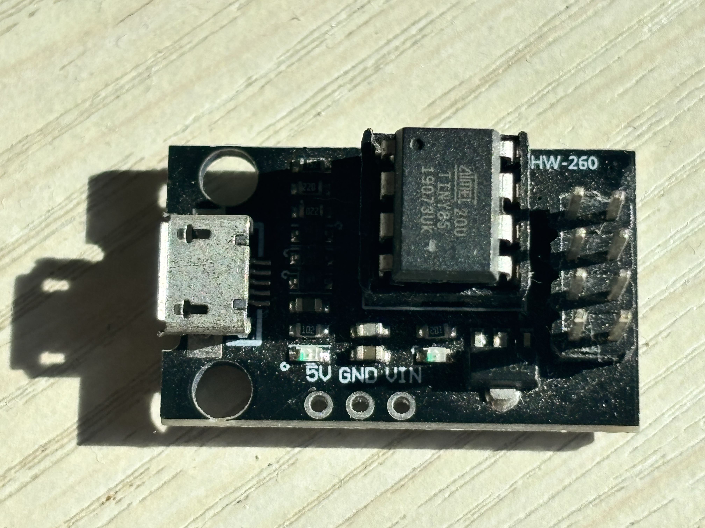
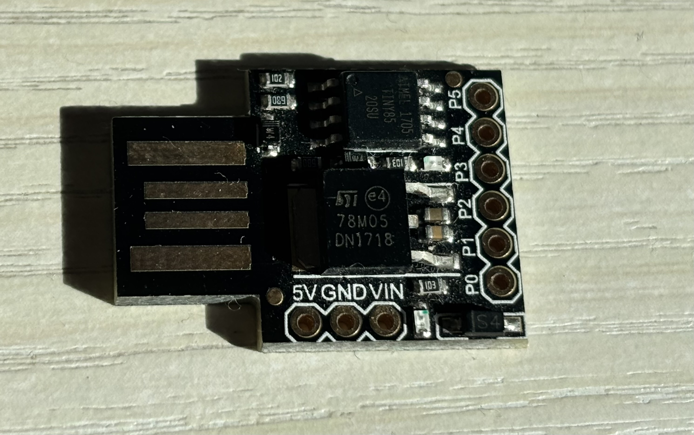

# How to Get Started with ATtiny85 Boards

This guide shows how to identify the two ATtiny85 boards in this folder, build a first blink sketch with PlatformIO, upload it over USB, and switch to ISP programming if USB upload is unavailable.

## 1. Identify your board

### HW-260 Micro-USB board



This board is marked **HW-260**, uses an ATtiny85, and has a Micro-USB connector. The photo does not show whether its chip has a Micronucleus bootloader installed.

### USB-A edge-connector board



This board has an ATtiny85-20SU, a USB-A edge connector, a 78M05 voltage regulator, and P0–P5 pads. Its layout resembles a Digispark-compatible board. The 78M05 regulates power; it is not a USB-to-serial chip.

Both boards can use USB programming when their USB circuitry works and a compatible Micronucleus bootloader is installed. The photos cannot confirm the bootloader state. The ATtiny85 has no hardware USB peripheral; Digispark-style boards implement USB in software.

## 2. Set up the PlatformIO project

The shared starter project is in `../platformio-starter`. Its `platformio.ini` has a `digispark-tiny` environment alongside the existing ESP8266 environment:

```ini
[env:digispark-tiny]
platform = atmelavr
board = digispark-tiny
framework = arduino
upload_protocol = micronucleus
```

Install [PlatformIO Core](https://platformio.org/install/cli), open a terminal in `../platformio-starter`, and build the ATtiny85 environment:

```sh
pio run -e digispark-tiny
```

The project sketch should be in `src/main.cpp`. A minimal blink sketch is:

```cpp
#include <Arduino.h>

const uint8_t LED_PIN = 1; // Digispark P1; try P0 if your board wires its LED there.

void setup() {
  pinMode(LED_PIN, OUTPUT);
}

void loop() {
  digitalWrite(LED_PIN, HIGH);
  delay(500);
  digitalWrite(LED_PIN, LOW);
  delay(500);
}
```

## 3. Upload over USB

Use a data-capable cable for the HW-260. Connect the edge-connector board through a USB-A port or suitable adapter. A red power LED confirms power only; it does not confirm a working USB data path.

Leave the board unplugged, then start the upload:

```sh
pio run -e digispark-tiny -t upload
```

When the uploader prints `Please plug in the device`, connect the board. No serial port needs to be selected. Wait for the uploader to report success.

If the upload succeeds but the user LED does not blink, change `LED_PIN` from `1` to `0` and upload again. The onboard power LED may stay lit independently of the sketch.

## 4. Troubleshoot USB upload

If Micronucleus reports `Device search timed out`:

1. Confirm the board is unplugged when starting the upload, then reconnect it only at the prompt.
2. Try a known data-capable cable, another USB port, and a different adapter or hub.
3. Check that nothing is connected to P3 or P4. Digispark-style boards use these pins for USB data.
4. If the host still does not detect the board, the bootloader may be missing or damaged. The power light alone cannot distinguish that from a USB data connection problem.

Do not select a serial port for Micronucleus uploads. Do not burn a bootloader or change fuse settings as part of an ordinary upload.

## 5. Program the chip with AVR ISP

Use an AVR ISP programmer, such as USBasp or an Arduino configured as ISP, if USB upload is unavailable. ISP can write a sketch directly or install a Micronucleus bootloader. It requires the ATtiny85 RESET pin to remain enabled for ISP.

| Programmer signal | ATtiny85 signal | DIP-8 package pin |
|---|---|---:|
| MOSI | PB0 / board P0 | 5 |
| MISO | PB1 / board P1 | 6 |
| SCK | PB2 / board P2 | 7 |
| RESET | PB5 / board P5 | 1 |
| VCC | VCC | 8 |
| GND | GND | 4 |

Disconnect other circuits from these pins while programming. Take care not to confuse board labels P0–P5 with physical DIP package pin numbers.

## 6. Read the references

- [PlatformIO Digispark USB board](https://docs.platformio.org/en/latest/boards/atmelavr/digispark-tiny.html) — board ID, MCU, clock, and framework settings.
- [Micronucleus bootloader](https://github.com/micronucleus/micronucleus) — USB bootloader behavior and command-line uploader.
- [Digispark schematic](https://s3.amazonaws.com/digistump-resources/files/97a1bb28_DigisparkSchematic.pdf) — example USB and GPIO wiring for a Digispark-style board.
- [ATtiny85 datasheet](https://ww1.microchip.com/downloads/aemDocuments/documents/OTH/ProductDocuments/DataSheets/Atmel-2586-AVR-8-bit-Microcontroller-ATtiny25-ATtiny45-ATtiny85_Datasheet.pdf) — pin functions, electrical limits, and ISP details.
- [ATTinyCore installation](https://github.com/SpenceKonde/ATTinyCore/blob/1.5.2/Installation.md) and [ATtiny x5 notes](https://github.com/SpenceKonde/ATTinyCore/blob/1.5.2/avr/extras/ATtiny_x5.md) — an Arduino IDE alternative.

## Verification status

The blink sketch built successfully for PlatformIO's `digispark-tiny` target (582 bytes of flash and 9 bytes of RAM in the tested build). A USB upload to the HW-260 previously timed out; physical upload has not yet been confirmed on either board.
